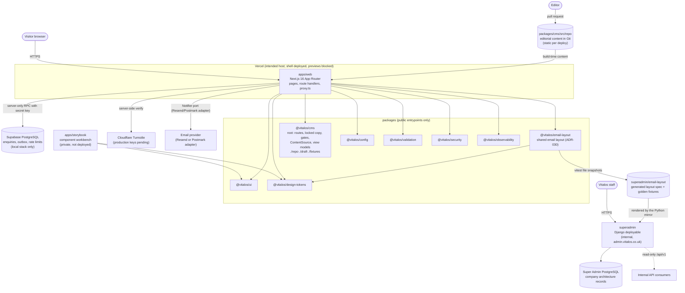
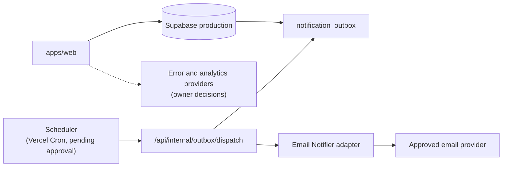

# Container architecture

Current state (12 Oct 2026, `stage-1` branch) and future state. The repository is a modular monolith with two deployable apps and shared packages (ADR-003), plus the separately deployed Django Super Admin (ADR-026). External systems below are the intended providers; none is connected to production yet.

## Current state

Notes:

- Solid lines exist in code; dashed lines are configured but inactive (no email adapter).
- The web app runs on the `repo` content source (ADR-028): the approved subset of the drafted content, static per deploy. `empty` is an honest empty state with all publication gates closed. `fixtures` (artificial content) is for tests and local work and is rejected in production; `draft` (content drafted from the strategy library, pending approval, ADR-025) is for review in local, preview and staging and is likewise rejected in production. See `docs/operations/local-development.md`.
- No CMS SDK is a dependency of the repository (ADR-028).
- Storybook is private by default and is not deployed.
- The web, Storybook and Super Admin are independent build/deployment units. Super Admin is an internal Django application with its own database and toolchain and no source imports in either direction (ADR-026).

## Runtime responsibilities (`apps/web`)

| Area                       | Location                                                 | Responsibility                                                                       |
| -------------------------- | -------------------------------------------------------- | ------------------------------------------------------------------------------------ |
| Pages and templates        | `app/(site)/**`, `src/templates/**`                      | Server-rendered routes from the route manifest; each template reads view models only |
| Content access             | `src/lib/cms/**`                                         | Selects the content source (ADR-028); content is static per deploy                   |
| SEO                        | `src/features/seo/**`, `app/sitemap.ts`, `app/robots.ts` | Metadata, JSON-LD, gate-aware sitemap, robots per environment                        |
| Redirects and gone         | `src/features/redirects/**`, `proxy.ts`                  | Version-controlled redirect map at build; 410 in the proxy                           |
| Publication gates          | `src/features/publication-gates/**`                      | `notFound()` for closed sections, `noindex` for their details                        |
| Enquiries                  | `src/features/enquiries/**`, `app/api/enquiries`         | Domain, application, adapters, composition root (ADR-019)                            |
| Security and observability | `src/config/security-headers.ts`, `instrumentation.ts`   | Headers and CSP per environment, structured logs, error reporter (ADR-020)           |

## Future state (documented, not built)

Further future containers (client portal, operations, docs, mobile apps, workers, public APIs, extracted services, containers and regional deployment) are not built. Extraction follows ADR-010 and `docs/architecture/future-service-model.md`: a service must own its data and expose versioned contracts (ADR-013). `services/` and `workers/` contain only templates.

## What changes with owner input

- Content changes: a pull request to `packages/cms/src/repo` (`docs/cms/editing-site-content.md`).
- Remote Supabase and email provider: set `VITALOS_ENQUIRY_BACKEND=supabase`; a `Notifier` adapter is the only new code.
- Scheduler, error provider and analytics provider are adapters behind existing interfaces.

See `docs/delivery/owner-decisions.md`.
