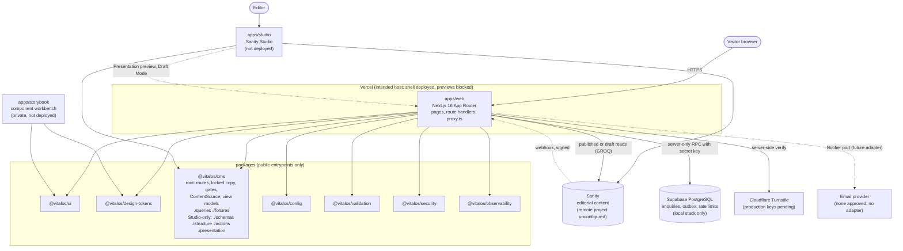
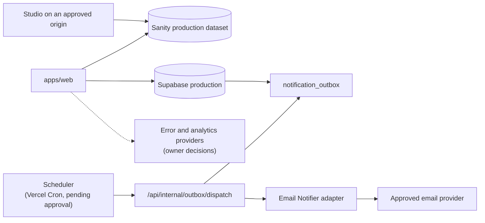

# Container architecture

Current state (10 Oct 2026, `stage-1` branch) and future state. The repository is a modular monolith with three deployable apps and shared packages (ADR-003). External systems below are the intended providers; none is connected to production yet.

## Current state

Notes:

- Solid lines exist in code; dashed lines are configured but inactive (no Sanity project, no webhook, no email adapter).
- With no Sanity configuration the web app runs on the `empty` content source (honest empty state, all publication gates closed). `fixtures` (artificial content) is for tests and local work and is rejected in production. See `docs/operations/local-development.md`.
- `apps/web` never imports `sanity`, `@vitalos/cms/schemas|structure|actions|presentation`. The Studio is a separate build and deployment unit.
- Storybook is private by default and is not deployed.

## Runtime responsibilities (`apps/web`)

| Area                       | Location                                                 | Responsibility                                                                                     |
| -------------------------- | -------------------------------------------------------- | -------------------------------------------------------------------------------------------------- |
| Pages and templates        | `app/(site)/**`, `src/templates/**`                      | Server-rendered routes from the route manifest; each template reads view models only               |
| Content access             | `src/lib/cms/**`                                         | Selects the content source, tag-cached published reads, draft reads, webhook, Draft Mode (ADR-018) |
| SEO                        | `src/features/seo/**`, `app/sitemap.ts`, `app/robots.ts` | Metadata, JSON-LD, gate-aware sitemap, robots per environment                                      |
| Redirects and gone         | `src/features/redirects/**`, `proxy.ts`                  | Version-controlled redirect map at build; 410 in the proxy                                         |
| Publication gates          | `src/features/publication-gates/**`                      | `notFound()` for closed sections, `noindex` for their details                                      |
| Enquiries                  | `src/features/enquiries/**`, `app/api/enquiries`         | Domain, application, adapters, composition root (ADR-019)                                          |
| Security and observability | `src/config/security-headers.ts`, `instrumentation.ts`   | Headers and CSP per environment, structured logs, error reporter (ADR-020)                         |

## Future state (documented, not built)

Further future containers (client portal, operations, docs, mobile apps, workers, public APIs, extracted services, containers and regional deployment) are not built. Extraction follows ADR-010 and `docs/architecture/future-service-model.md`: a service must own its data and expose versioned contracts (ADR-013). `services/` and `workers/` contain only templates.

## What changes with owner input

- Remote Sanity project and webhook: set `VITALOS_CONTENT_SOURCE=sanity` and the Sanity variables; no code change.
- Remote Supabase and email provider: set `VITALOS_ENQUIRY_BACKEND=supabase`; a `Notifier` adapter is the only new code.
- Scheduler, error provider and analytics provider are adapters behind existing interfaces.

See `docs/delivery/owner-decisions.md`.
