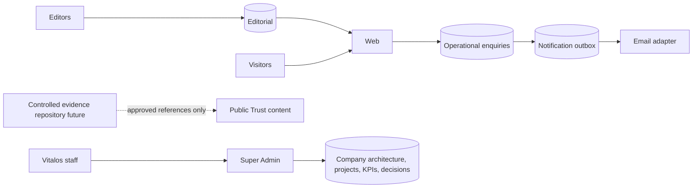

# Data ownership

Email failure never removes a stored enquiry. Super Admin owns the internal company architecture records; they are classified Public/Internal/Confidential/Restricted, archived rather than deleted and fully history-tracked. Public clients have no table privileges. Extracted services must own their persistence.
