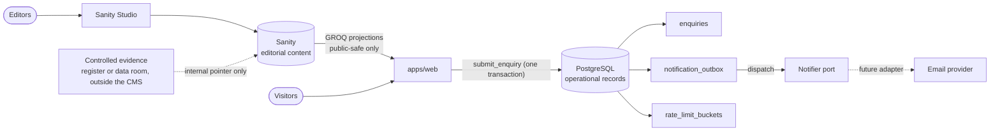

# Data ownership

One owner per kind of data. Nothing is shared by writing to another system's store. Current state is what the `stage-1` branch implements; future items are marked.

| Data                                                                                                                                  | Owner                                                          | Notes                                                                                                                                                                    |
| ------------------------------------------------------------------------------------------------------------------------------------- | -------------------------------------------------------------- | ------------------------------------------------------------------------------------------------------------------------------------------------------------------------ |
| Editorial content (practices, offers, case studies, insights, people, labs, trust, legal pages, route copy, redirects, site settings) | Sanity                                                         | Structured, governed documents (ADR-017, `docs/cms/content-model.md`). Published documents are readable through the dataset API, so nothing controlled is ever published |
| Locked copy, route manifest, navigation, publication-gate thresholds                                                                  | Code (`packages/cms`)                                          | Policy, not content. Changes are reviewed code changes (ADR-022)                                                                                                         |
| Design tokens                                                                                                                         | Code (`packages/design-tokens`); Figma is the design authority | Raw colours exist only here (ADR-016)                                                                                                                                    |
| Enquiries, outbox, rate-limit counters                                                                                                | PostgreSQL (Supabase)                                          | Written only by the server through `SECURITY DEFINER` functions; `anon` and `authenticated` have no privileges; RLS on (ADR-006, ADR-019)                                |
| Controlled evidence (contracts, client permissions, certificates, audit reports)                                                      | A controlled register outside the public CMS                   | Sanity holds only a single-line internal pointer (`evidenceReference`, max 200 chars) and a status. Not yet established; owner decision                                  |
| Secrets                                                                                                                               | Provider encrypted stores                                      | Never in Git, bundles, logs, fixtures or Sanity (`docs/security/secret-management.md`)                                                                                   |
| Logs and error reports                                                                                                                | Provider-neutral logger, console today                         | Identifiers, counts and error codes only; personal data redacted by key (`docs/operations/observability.md`)                                                             |

## Enquiry record rules

- Email is a notification channel, not the database. A failed or missing notification never removes a stored enquiry.
- The enquiry row and its outbox row are written in one transaction; a replayed idempotency key returns the original reference and writes nothing.
- The client IP is stored only as an HMAC under a server-side salt (`ip_hash`). The outbox payload carries identifiers only; personal data is read from the enquiry at send time.
- Consent time and the privacy notice version are stored with each enquiry. `retention_until` is null until the owner approves a retention policy; no deletion job exists.
- Production data is never copied to preview or staging; non-production environments use separate secrets and data (ADR-015).

## What the CMS never holds

Prices; evidence itself; client names or logos without verified permission; certifications that are not verified, scoped, dated and current; HTML, CSS or class names; enquiry data. Queries additionally drop controlled, archived, unverified and rights-unapproved items before the web app sees them.

## Future

An extracted service owns its persistence and shares no private tables (ADR-010). Any later client, operations or analytics data store needs its own ADR and ownership entry here. No such store exists today.
