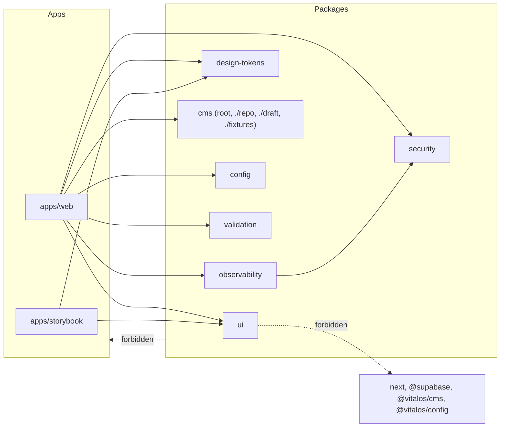

# Dependency rules

Rules from ADR-009, extended by ADR-022. They are enforced, not advisory: `corepack pnpm check:boundaries` runs dependency-cruiser (`dependency-cruiser.cjs`) over `apps`, `packages`, `services` and `workers`, and runs in `check` and CI.

## Enforced rules (dependency-cruiser)

| Rule                              | Meaning                                                                                                                                               |
| --------------------------------- | ----------------------------------------------------------------------------------------------------------------------------------------------------- |
| `no-circular`                     | No import cycles anywhere                                                                                                                             |
| `no-app-to-app`                   | An app never imports another app's source                                                                                                             |
| `no-package-to-app`               | Shared packages never import apps                                                                                                                     |
| `no-domain-to-ui`                 | Code under `domain/` or `features/` never imports `packages/ui`                                                                                       |
| `cms-public-entry-framework-free` | The `@vitalos/cms` root entry, routes, navigation, locked copy and `content/` never import `next`, `react`, `sanity`, `groq` or `@sanity/*` (ADR-028) |
| `ui-no-framework-or-platform`     | `packages/ui` is presentation only: no `next`, `@supabase`, `@vitalos/cms` or `@vitalos/config`; links are plain anchors                              |
| `motion-only-in-ui`               | Only `packages/ui` imports `motion`, `framer-motion`, `motion-dom` or `motion-utils` (ADR-024); apps use its client islands                           |

## Conventions (reviewed, partly tested)

- Applications use `@vitalos/*` public entrypoints only. Entry points are the `exports` map of each package (for example `@vitalos/security/headers`, `@vitalos/config/build`); no deep imports and no shared barrels.
- Server-only values stay server-only: `@vitalos/config` root imports `server-only`; `@vitalos/config/public` and `/build` are safe for client bundles and `next.config.ts`. `corepack pnpm check:bundle-secrets` scans the built client bundle for server env names and secret patterns.
- No raw colours outside `packages/design-tokens` (`corepack pnpm check:raw-colours`, part of `check`).
- Enquiry code is layered inside `apps/web/src/features/enquiries`: `domain` (model, events, ports) and `application` import no framework or provider; `adapters` implement the ports; `composition.ts` is the only place that picks adapters (ADR-019).
- Pages get content only through `getContentSource()`; they never construct a source themselves (ADR-028). Public URLs come only from `routes.ts` (ADR-022).
- Business rules live outside UI and route handlers; route handlers validate external input and authorise on the server.
- Provider code sits behind interfaces: `ContentSource`, `EnquiryRepository`, `RateLimiter`, `HumanVerifier`, `OutboxStore`, `Notifier`, `ErrorReporter`.
- Only one open pull request may change `pnpm-lock.yaml` or a `package.json` at a time.

## Services and workers (future)

No services exist (`services/_template`, `workers/_template` are templates). Extracted services integrate through versioned APIs or events, own their data and never share a database with the web app (ADR-010, ADR-013).

## Adding or changing a rule

Change `dependency-cruiser.cjs`, add or adjust a fixture import to prove the rule fails when violated, update this page, and record the reason in an ADR if the architecture changes.
