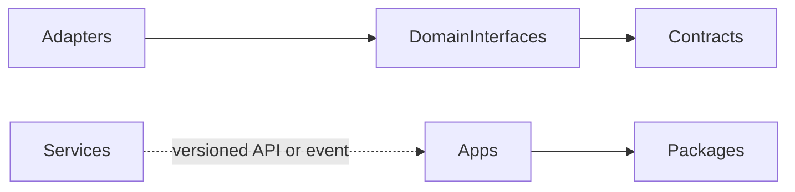

# Dependency rules

No app-to-app source imports, cycles, client imports of server-only packages, or shared-database services. `dependency-cruiser` enforces the graph; package exports define public APIs.
