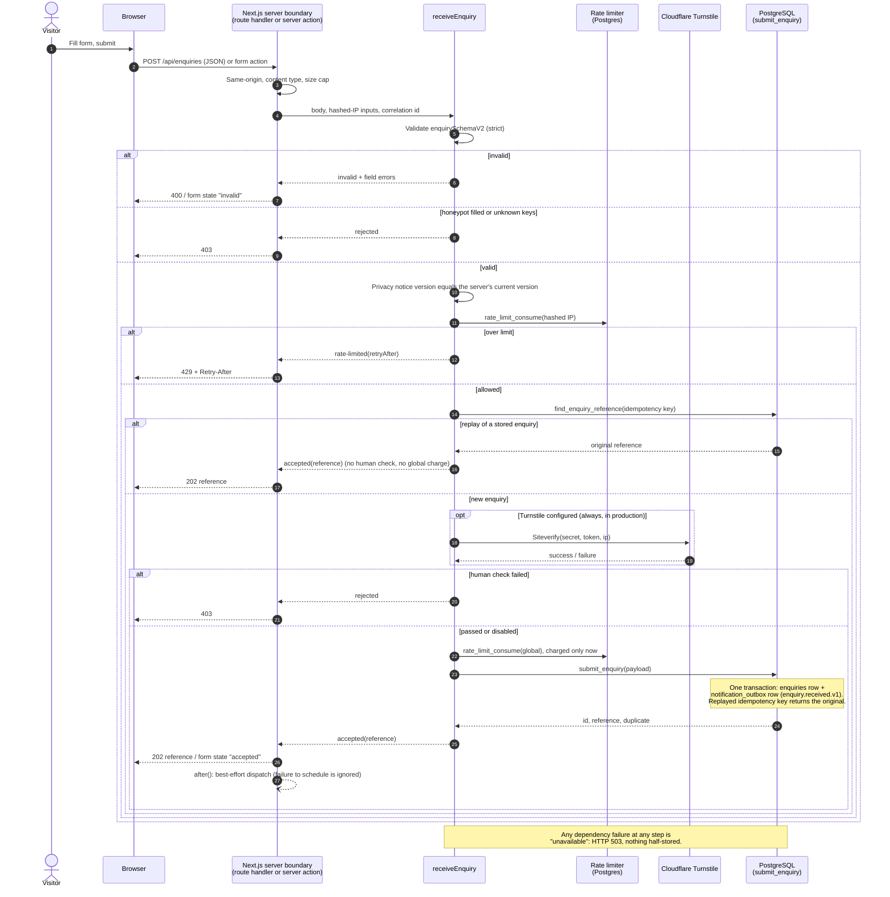
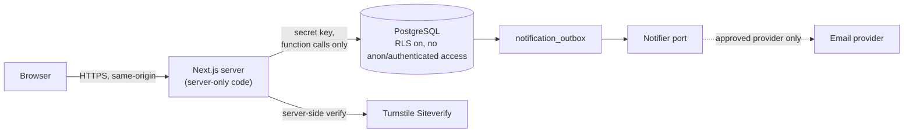

# Enquiry sequence

How a website enquiry becomes a durable record and a notification (ADR 019). Email is a notification channel; the database is the record.

## Submission



## Notification (outbox dispatch)

```mermaid
sequenceDiagram
    autonumber
    participant S as Trigger<br/>after() / scheduler / local script
    participant R as /api/internal/outbox/dispatch<br/>(Bearer secret)
    participant X as dispatchOutbox
    participant D as PostgreSQL<br/>(claim_outbox_batch, mark_outbox)
    participant N as Notifier<br/>(console now; email provider later)

    S->>R: POST (Authorization: Bearer ...)
    R->>X: dispatch one batch
    X->>D: claim_outbox_batch(n)
    Note over D: FOR UPDATE SKIP LOCKED, attempts + 1,<br/>5 minute lease. Expired leases are reclaimed.<br/>attempts is the lease token: a stale worker cannot mark a re-claimed row.
    D-->>X: work items (enquiry + event)
    loop each item
        X->>N: send(kind, idempotency key enquiryId:kind)
        alt sent
            X->>D: mark_outbox(id, attempts, sent)
        else retryable failure, attempts left
            X->>D: mark_outbox(id, attempts, pending, code, backoff)
            Note over X,D: 60 s, 120 s, 240 s ... capped at 1 h
        else permanent failure or attempts exhausted
            X->>D: mark_outbox(id, attempts, failed, code)
            Note over D: Dead-letter: stays visible for operators.<br/>The enquiry itself is never lost.
        end
    end
    R-->>S: counts only (claimed, sent, retried, failed)
```

## Data and trust boundaries



- The browser never touches tables or functions; `anon` and `authenticated` have no privileges.
- Logs carry identifiers, counts and error codes. They never carry name, email, goal or organisation. The IP exists only as a salted hash.
- The outbox payload carries identifiers only. The notifier receives the enquiry content in memory at send time.
