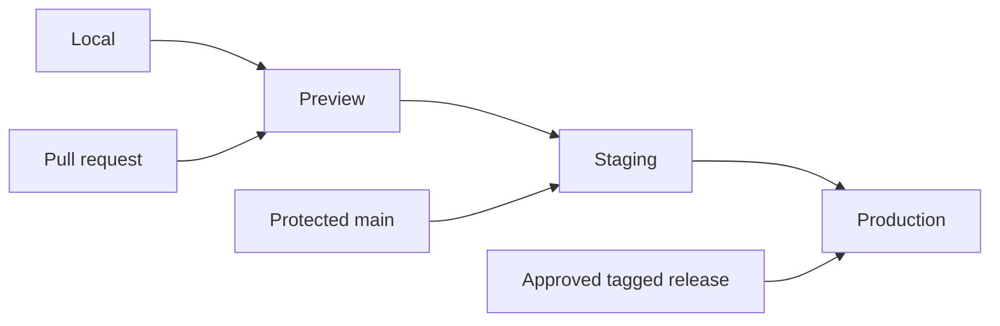

# Environment model

Use isolated secrets/data, noindex preview/staging, production-only analytics and no copied live enquiries. Vercel Preview is current intent; dedicated staging depends on plan/workflow justification.
