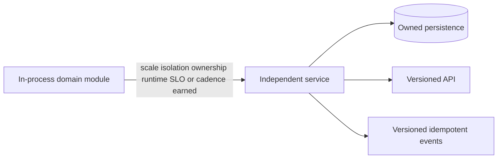

# Future service model

Events use `eventId`, `eventType`, `eventVersion`, `occurredAt`, `producer`, `correlationId`, `causationId`, and `payload`. Do not introduce an event bus until a durable asynchronous boundary exists.
