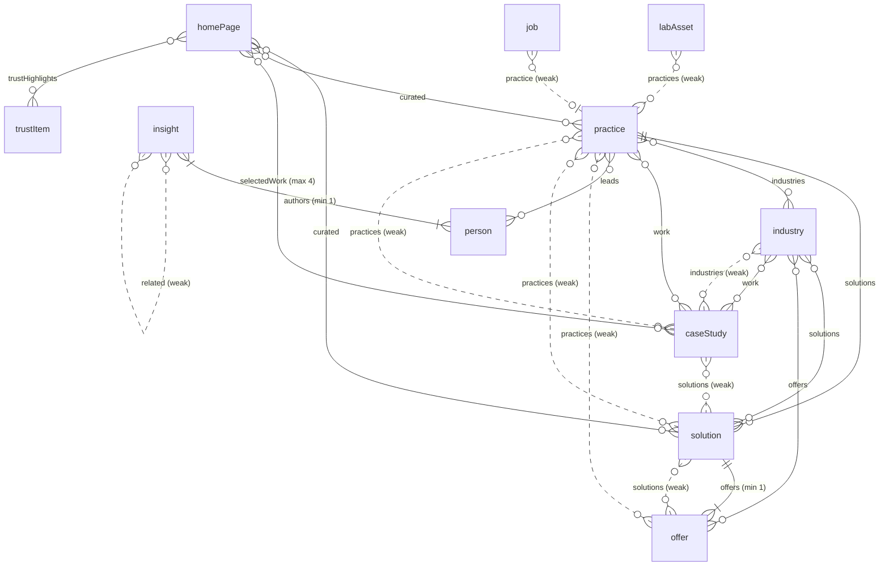

# Content model

Sanity owns editorial content; PostgreSQL owns operational records; controlled evidence stays outside the public CMS (ADR 005, ADR 006). This page describes the Sanity schema set in `packages/cms/src/schemaTypes` (decision record: ADR 017). The web app never imports it: it reads the view models in `packages/cms/src/content/types.ts` through `ContentSource` (ADR 022).

## Entity relationships

Solid arrows are the editorial (forward) reference. Dashed arrows are weak back-pointers that exist so two sides can be published in either order. Reverse relations the view models need are derived by queries.

Every document also has `governance`, `locale` (hidden, `en-GB`) and, except `redirect`, SEO (`seo`, or `defaultSeo` on `siteSettings`).

## Reusable objects

| Type            | Fields and rules                                                                                                                                                                      |
| --------------- | ------------------------------------------------------------------------------------------------------------------------------------------------------------------------------------- |
| `seo`           | `title` (max 60), `description` (max 160), `noindex`, `ogImage`                                                                                                                       |
| `governance`    | `owner`, `editorialStatus` (draft, review, approved, needs-review, archived), `reviewDate`; an approved item with a past review date fails                                            |
| `evidence`      | `evidenceStatus` (verified, pending, n/a), `classification` (public, controlled; no default), `evidenceOwner`, `evidenceReference` (internal pointer), `verifiedAt`                   |
| `cta`           | `label` (warns on "Learn more" and similar), `intent`, exactly one of `internalRef` (document) or `routeKey`                                                                          |
| `approvedImage` | image with `alt` (required unless `decorative`), `rightsStatus` (approved, pending), `credit`                                                                                         |
| `richText`      | styles normal, h2, h3, h4; bullet and numbered lists; strong, em, code; https-only links; internal reference links; blocks `callout`, `pullQuote`, `figure`, `codeBlock`, `dataTable` |
| `callout`       | `tone`, `title`, `body`                                                                                                                                                               |
| `pullQuote`     | `quote`, `attribution` (required), `role`                                                                                                                                             |
| `figure`        | `kind` (image, diagram), `image`, `caption`, `textAlternative` (required for diagrams)                                                                                                |
| `codeBlock`     | `language`, `filename`, `code`                                                                                                                                                        |
| `dataTable`     | `caption` (required), `columns` (2-8), `rows[].cells` (must match columns)                                                                                                            |

Rendering note: the web RichText renders `dataTable` through `@vitalos/ui` `EvaluationTable` (real `<table>`, `<caption>`, column headers, first cell of each row as the row header, stacked labelled rows below `md`). A table with no caption, fewer than two column headings, a ragged row, a blank row header or no rows is not rendered (logged outside production).
| `stat` | `value`, `descriptor`, `source` (required), `evidence` (required) |
| `outcomeMetric` | as `stat` plus `context` (required), `timeframe` |
| `testimonial` | `quote`, `attribution` (required), `role`, `permissionStatus` (granted, pending), `permissionEvidence` (verified when granted) |
| `hero` | `eyebrow`, `image`, `primaryCta` (optional supporting elements; the homepage hero copy is locked in code) |

## Documents

Fields below are the query surface for C2. All documents also carry `governance` and `locale`; page documents carry `seo`.

| Type           | Key fields                                                                                                                                                                                                                                                                                                                                                                                | Validation highlights                                                                                                                                                                                                        |
| -------------- | ----------------------------------------------------------------------------------------------------------------------------------------------------------------------------------------------------------------------------------------------------------------------------------------------------------------------------------------------------------------------------------------- | ---------------------------------------------------------------------------------------------------------------------------------------------------------------------------------------------------------------------------- |
| `practice`     | `title`, `slug`, `summary`, `hero`, `proposition`, `problems[]`, `capabilities[]`, `body`, `leads[]->person`, `solutions[]->solution`, `industries[]`, `work[]`, `insights[]`, `labs[]`, `cta`                                                                                                                                                                                            | problems and capabilities min 1; offers are derived from `offer.practices`                                                                                                                                                   |
| `solution`     | `title`, `slug`, `summary`, `hero`, `problemStatement`, `signals[]`, `impact`, `approach`, `phases[{title,description}]`, `offers[]->offer`, `practices[]` (weak), `industries[]` (weak), `work[]`, `labs[]`, `insights[]`, `faq[{question,answer}]`, `cta`                                                                                                                               | at least one offer                                                                                                                                                                                                           |
| `offer`        | `title`, `slug`, `summary`, `hero`, `audience`, `trigger`, `scope`, `outputs[]`, `requirements[]`, `durationCategory` (short, medium, long, ongoing), `exclusions[]`, `nextStep`, `solutions[]` (weak), `practices[]` (weak), `work[]`, `cta`                                                                                                                                             | no price field; at least one solution or practice (no orphans)                                                                                                                                                               |
| `industry`     | `title`, `slug`, `summary`, `hero`, `realities[]`, `problems[]`, `aiOpportunities[]`, `considerations[]`, `body`, `solutions[]`, `offers[]`, `work[]`, `insights[]`, `cta`                                                                                                                                                                                                                | realities and problems min 1                                                                                                                                                                                                 |
| `caseStudy`    | `title`, `slug`, `summary`, `engagementBasis` (contracted-by-vitalos, prior-team-experience), `clientDisplay` (named, anonymised), `clientName`, `permissionEvidence`, `anonymisedDescriptor`, `sector`, `challenge`, `approach`, `outcome`, `metrics[outcomeMetric]`, `testimonial`, `disclosureApproved`, `evidence`, `practices[]` (weak), `solutions[]` (weak), `industries[]` (weak) | named needs `clientName` and verified `permissionEvidence`; anonymised must not carry `clientName` and needs `anonymisedDescriptor`; figures need `disclosureApproved`; `evidence` verified is what counts for the Work gate |
| `insight`      | `title`, `slug`, `summary`, `format` (7 formats, Stage 8 §16), `topics[]` (10 topics, max 3), `authors[]->person` (min 1), `publishedAt`, `updatedAt`, `body`, `industries[]`, `practices[]`, `related[]`, `cta`                                                                                                                                                                          | `updatedAt` not before `publishedAt`                                                                                                                                                                                         |
| `person`       | `name` (no `title`), `slug`, `role`, `isLeadership`, `summary`, `bio`, `portrait`, `expertise[]`, `credentials[{label,evidence}]`, `sameAs[{label,url,verified}]`                                                                                                                                                                                                                         | https profile links; credentials need evidence; only `verified` links are public; insights are derived from `insight.authors`                                                                                                |
| `labAsset`     | `title`, `slug`, `summary`, `labType`, `maturity`, `is`, `isNot`, `limitations`, `body`, `maintained`, `repoUrl`, `demoUrl`, `evidence`, `supportEvidence`, `practices[]`, `industries[]`                                                                                                                                                                                                 | `limitations` required; links only when `maintained`; `production-product` needs verified `supportEvidence`; slug unique per `labType`                                                                                       |
| `trustItem`    | `title`, `topic`, `summary`, `publicSummary`, `evidence` (carries the public or controlled `classification`), `certifications[{name,scope,issuedAt,expiresAt,evidence}]`, `subprocessors[{name,purpose,location}]`, `contactEmail`                                                                                                                                                        | one per topic; certifications verified, scoped, dated and current; controlled flagged and holds no public rows                                                                                                               |
| `job`          | `title`, `slug`, `summary`, `practice`, `employmentType`, `location`, `datePosted`, `validThrough`, `status` (open, closed), `applicationUrl`, `description`                                                                                                                                                                                                                              | open needs https `applicationUrl`, `description` and a current `validThrough`                                                                                                                                                |
| `legalPage`    | `title`, `slug` (privacy, cookies, terms, acceptable-use), `version`, `effectiveDate`, `body`                                                                                                                                                                                                                                                                                             | slug restricted to `legalSlugs`                                                                                                                                                                                              |
| `routePage`    | `routeKey` (13 keys), `heading`, `intro`, `hero`, `body`, `cta`, and for `contact` only `expectations`, `successMessage`, `routes[{intent,label,description}]`                                                                                                                                                                                                                            | one per key; contact-only fields rejected elsewhere; unique intents                                                                                                                                                          |
| `homePage`     | singleton: `homeSections[{sectionKey,visibleHeading}]`, `proof[{label,evidence,href}]`, `solutions[]`, `practices[]`, `selectedWork[]`, `industries[]`, `trustHighlights[]`, `labs[]`, `insights[]`, `leadership[]`, `finalCta`                                                                                                                                                           | `selectedWork` max 4; unique section keys; headings are Studio initial values only                                                                                                                                           |
| `siteSettings` | singleton: `legalName`, `companyNumber`, `registeredAddress`, `contactEmail`, `securityEmail`, `social[{label,href,verified}]`, `logo`, `defaultSeo`                                                                                                                                                                                                                                      | emails valid; https social links; company number format warned                                                                                                                                                               |
| `redirect`     | `source`, `status` (301, 308, 410), `destination`, `reason`                                                                                                                                                                                                                                                                                                                               | see below                                                                                                                                                                                                                    |

### Redirect rules

Source starts with a single `/`, has no query, fragment, spaces or trailing slash, and is not a live static page or an API route. 410 has no destination; 301 and 308 need an internal path or https URL that is not the source. Sources are unique, and chains are rejected in both directions (this destination is another redirect's source, or another redirect points at this source), including redirects into a 410. The seeded legacy redirects owned by the web app (`/services`, `/technologies`, `/privacy`, `/terms`) live in code, not in this dataset; the Studio rule does not see them.

## Editorial workflow in the Studio

- **Desk:** Homepage and Site settings pinned first; groups Commercial, Proof and authority, Trust and legal, Careers, Page content, Redirects; queues "Needs review" (review date before today, not archived) and "Awaiting approval" (status review).
- **Publish:** blocked unless `editorialStatus` is approved, owner and review date are present and current, there are no validation errors, and the document is not controlled content. Warnings do not block.
- **Slug or lab type change on a published document:** a warning appears while editing; publishing creates a draft 301 redirect (id `drafts.redirect-<old-path>`) in review status for an editor to approve. Chains and duplicates are rejected when that redirect is validated.
- **Preview:** Presentation tool with resolvers derived from `routes.ts`; draft mode via `/api/draft-mode/enable`. Preview origin is `SANITY_STUDIO_PREVIEW_URL`.
- **Singletons:** cannot be duplicated, deleted or unpublished, and are not in the global "new document" menu.

## What the model deliberately does not hold

Prices; the evidence behind a claim (only an internal pointer); client logos or names without verified permission; certifications that are not verified, scoped, dated and current; copy that is locked in `locked-copy.ts` (descriptor, proposition, brand line, navigation labels, CTAs, practice, solution, offer and industry names, AI journey and How We Work stages, homepage structural labels). Owner-blocked content (legal identity, bios, case studies, trust statements, legal text) is entered in Sanity by the owner and is never invented in code.

## For query authors (C2)

- Exclude from every public projection: `evidence.classification == "controlled"`, `governance.editorialStatus == "archived"`, certification rows whose evidence is not verified or whose `expiresAt` has passed, testimonials whose `permissionStatus != "granted"`, `approvedImage` with `rightsStatus != "approved"`, `sameAs` and `social` entries that are not `verified`, lab `repoUrl` and `demoUrl` when `maintained != true`.
- The `evidenceReference`, `evidenceOwner` and `permissionEvidence` fields are internal and must not appear in any projection.
- Union both directions of weak relations (offer to solution and solution to offer; solution or case study to practice).
- Slugs: `slug.current` on routable documents; `person.name` is the title; trust items are addressed by `topic`; legal pages by `slug.current` in `legalSlugs`; lab assets by `labType` plus `slug.current`.
- Homepage headings come from `homeSections[].visibleHeading` keyed by `sectionKey`; no entry means no heading.
